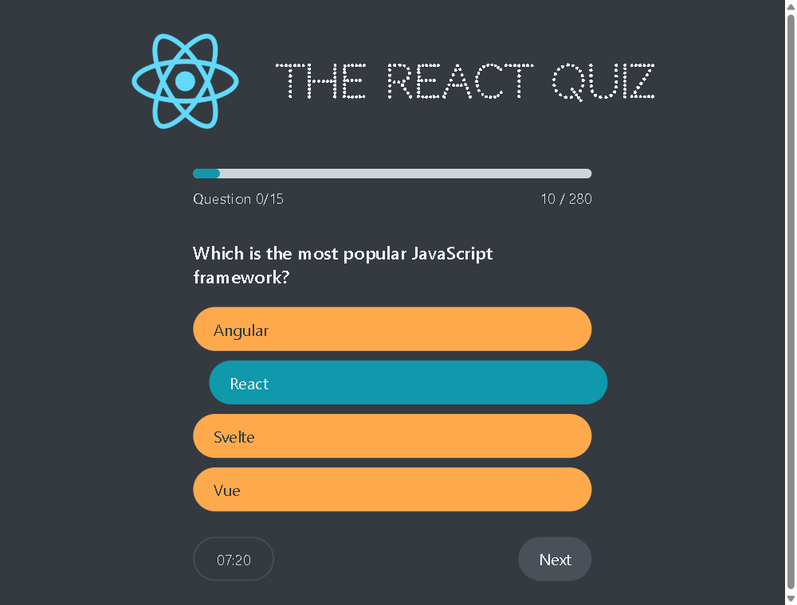

# The React Quiz

A 15-question quiz. 30 seconds per question, points per correct answer, and it
keeps your highscore.



I built this while learning `useReducer`. One reducer holds everything —
`status`, `index`, `points`, `secondsRemaining` — and `status` decides what is
on screen: `loading → ready → active → finished`.

## Running it

Two terminals, because the questions come from `json-server`:

```bash
npm install

npm run server   # http://localhost:8000
npm start
```

## What I would change

The code is as I first wrote it. Reading it back, this is what I would fix:

- `finsh.js` should be `Finish.js`. Components start with a capital, and the
  word is misspelled. Same for the `restrat` action and `qusetions` on the
  start screen.
- The questions should ship with the app instead of being served by
  `json-server`, so it runs with one command and can be hosted.
- `Questions.js` still has a `console.log` in it.
- The timer keeps counting while the tab is in the background.
- `Error` is both an imported component and the global constructor used in the
  reducer's `default` case. The two collide.

I have left them. This is the project where `useReducer` went from something I
had read about to something I reach for, and the version I actually wrote is
more useful to show than one tidied up afterwards.

`DateCounter.js` is a separate `useReducer` exercise, not part of the quiz.

---

An early React project of mine. I build with Vite now.
